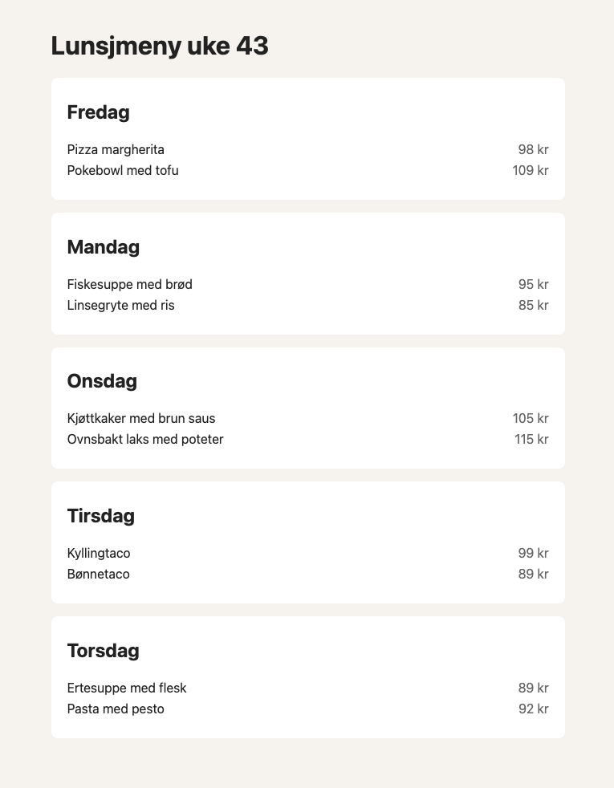
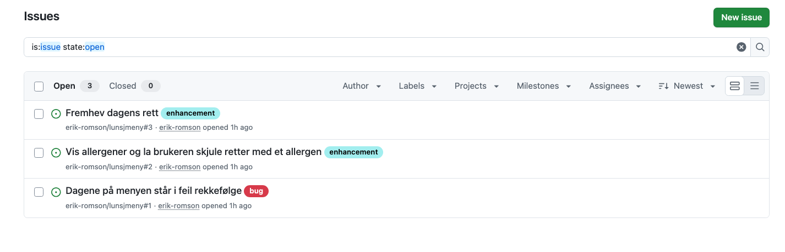

# Lunsjmeny

Ukas lunsjmeny i kantina, som én nettside. Menyen ligger i `menu.json`.

Dette er demoprosjektet til foredraget «Scripting med AI-agenter» på AI-fagkvelden til Zenior og Overhuset,
18. november 2026. Appen er med vilje liten: testene tar et sekund og bygget under et minutt, så det er
agentene og scriptene rundt dem som får oppmerksomheten.



## Kjør den

```sh
uv run flask --app app run --port 8000   # siden på http://localhost:8000
uv run pytest -q                         # testene
```

## Sakene i demoen

Repoet har tre åpne saker, to utvidelser og én bug. Feilene er med vilje, så ikke rett dem i `main`.



| Sak | Type | Hva |
|---|---|---|
| [#1](https://github.com/erik-romson/lunsjmeny/issues/1) | bug | Dagene står alfabetisk, med fredag øverst. De skal stå fra mandag til fredag. |
| [#2](https://github.com/erik-romson/lunsjmeny/issues/2) | enhancement | Vis allergenene på hver rett, og la brukeren skjule retter med et allergen. |
| [#3](https://github.com/erik-romson/lunsjmeny/issues/3) | enhancement | Fremhev dagens rett. |

Under foredraget starter `scripts/start-demo.sh` alle tre: én kopi av repoet per sak, hver på sin egen branch,
og en pipeline i hver kopi som går fra sak til draft-PR. Hver kjøring går i sin egen tmux-sesjon.

```sh
scripts/start-demo.sh      # lag kopiene og start kjøringene
tmux attach -t lunsj-1     # se på kjøringen for sak 1 (Ctrl-b d for å gå ut)
```

Scriptet trenger `draupnir`, `tmux`, `uv` og en norn-checkout (`NORN_DIR`).

## Kode

- `menu.py` leser menyen og gjør den klar for siden. Den importerer ikke Flask og testes med vanlige funksjoner.
- `app.py` og `templates/index.html` lager siden.
- `tests/` har testene, og GitHub Actions kjører dem ved hver push.
